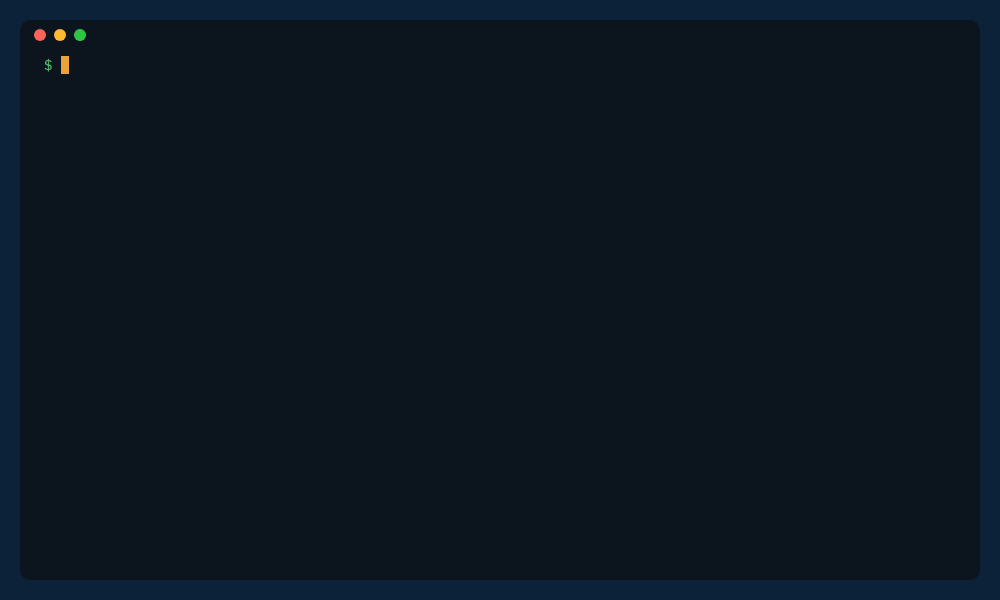

<picture>
  <source media="(prefers-color-scheme: dark)" srcset=".github/readme/hero-dark.svg">
  
</picture>

<p align="center">
  <a href="https://github.com/keelinfra/jenkins-bench/actions/workflows/ci.yml"></a>
  <a href="https://github.com/keelinfra/jenkins-bench/releases/latest"></a>
  <a href="#coverage"></a>
  <a href="#what-the-token-can-read"></a>
  <a href="#license"></a>
</p>

<p align="center">
  <a href="#try-it"><b>Try it</b></a> &nbsp;·&nbsp;
  <a href="#install"><b>Install</b></a> &nbsp;·&nbsp;
  <a href="#coverage"><b>Coverage</b></a> &nbsp;·&nbsp;
  <a href="docs/guide.md"><b>Guide</b></a> &nbsp;·&nbsp;
  <a href="README.zh-CN.md"><b>简体中文</b></a>
</p>

<br>

jenkins-bench audits a **Jenkins controller** against the Build Pipelines section of the [CIS Software Supply Chain Security Guide](https://www.cisecurity.org/benchmark/software-supply-chain-security). It takes a **read-only** snapshot of the controller (jobs, credentials metadata, agents, plugins), evaluates it with one Rego policy per control, and tells you what is misconfigured and the exact settings path that fixes it.

```sh
jenkins-bench scan --url https://jenkins.example.com --username audit --token "$JENKINS_TOKEN"
```

### Try it

No controller and no token needed: `--demo` evaluates a sample controller built into the binary.

```sh
docker run --rm -t ghcr.io/keelinfra/jenkins-bench:latest scan --demo
```

<p align="center">
  
</p>

## A control it cannot see reports MANUAL

**A control that cannot be evaluated reports `MANUAL`, never `PASS` or `FAIL`.** A scan is never credited for a question it could not ask, and never penalised for one either.

On Jenkins this matters at once. A least-privilege token (`Overall/Read` plus `Job/Read`) cannot read a single job's configuration, so every job-scope control reports `MANUAL`, the scan says so on stderr, and the score leaves them out. `scan.maxManual` lets CI refuse a scan that saw too little. A scan that could not finish, such as a token that gets an empty job list, exits 2 instead of 0.

## What the token can read

Measured against Jenkins 2.580.1, with one account per row in [`hack/e2e`](hack/e2e):

| Token permission | What becomes answerable |
| --- | --- |
| `Overall/Read` | authentication, CSRF, the anonymous probe, the built-in node, agents |
| + `Job/Read` | the job list and which jobs are disabled; without it Jenkins returns an *empty* list and the scan exits 2 |
| + `Job/ExtendedRead` | everything job-scope: how each job is defined, its sandbox and Groovy scripts, its triggers |
| + `Overall/SystemRead` | plugins and their update state |
| + `Credentials/View` | credential metadata from the controller's own stores |

Scan with `Overall/Read`, `Job/Read`, `Job/ExtendedRead` and `Overall/SystemRead`: that answers every automated control and can change nothing. The last two are opt-in; start the controller with `-Dhudson.security.ExtendedReadPermission=true` and `-Djenkins.security.SystemReadPermission=true`. Use an API token, not a password.

Every request is a GET. A test enforces it, the HTTP client refuses anything else, and every scan ends with the count:

```
[INFO] ✓ 31 requests · 31 GET · 0 writes · read-only
```

The snapshot never holds a secret: a trigger token is recorded as present or absent, and credentials in SCM URLs are stripped, so a `--snapshot-out` file is safe to attach to a bug report.

## Install

```sh
go install github.com/keelinfra/jenkins-bench/cmd/jenkins-bench@latest
```

Or take an archive from [Releases](https://github.com/keelinfra/jenkins-bench/releases) (checksums signed with cosign, SBOM and build provenance attached), or the container image `ghcr.io/keelinfra/jenkins-bench`.

```sh
jenkins-bench scan ... --details                       # per-job findings, full remediation
jenkins-bench scan ... --folder platform --job deploy   # narrow the scan
jenkins-bench scan ... -o sarif --output-file jenkins.sarif   # also json, junit
jenkins-bench scan ... --snapshot-out jenkins.json      # re-evaluate later, offline
jenkins-bench init                                      # commented config, every default stated
```

Exit codes, CI recipes for GitHub Actions, Jenkins and Azure Pipelines, large controllers, scoring and configuration are in the **[guide](docs/guide.md)**.

## Coverage

Section 2 of the guide has 28 controls. These 15 are every one that a controller's API can answer, plus the ones whose only honest form is a manual check that says where the answer lives. The rest are measured against a live controller before they ship, not guessed at.

| ID | Severity | Scope | Automated | Title |
| --- | --- | --- | --- | --- |
| CIS-2.1.1 | MEDIUM | job | manual | Ensure each pipeline has a single responsibility |
| CIS-2.1.2 | HIGH | job | yes | Ensure all aspects of the pipeline infrastructure and configuration are immutable |
| CIS-2.1.3 | MEDIUM | controller | yes | Ensure the build environment is logged |
| CIS-2.1.4 | MEDIUM | controller | manual | Ensure the creation of the build environment is automated |
| CIS-2.1.5 | MEDIUM | controller | yes | Ensure access to build environments is limited |
| CIS-2.1.6 | HIGH | controller | yes | Ensure users must authenticate to access the build environment |
| CIS-2.2.1 | MEDIUM | controller | manual | Ensure build workers are single-used |
| CIS-2.2.3 | HIGH | controller | yes | Ensure the duties of each build worker are segregated |
| CIS-2.2.4 | MEDIUM | controller | manual | Ensure build workers have minimal network connectivity |
| CIS-2.2.6 | MEDIUM | controller | manual | Ensure build workers are automatically scanned for vulnerabilities |
| CIS-2.3.1 | HIGH | job | yes | Ensure all build steps are defined as code |
| CIS-2.3.4 | MEDIUM | job | manual | Ensure changes to pipeline files are tracked and reviewed |
| CIS-2.3.5 | MEDIUM | job | yes | Ensure access to build process triggering is minimized |
| CIS-2.3.8 | MEDIUM | controller | manual | Ensure scanners are in place to identify and prevent sensitive data in pipeline files |
| JENKINS-PLUGIN-UPDATES | MEDIUM | controller | yes | Ensure installed plugins are up to date |

What each control actually reads, and the API findings behind them, are in the [guide](docs/guide.md#coverage) and [`docs/jenkins-api-notes.md`](docs/jenkins-api-notes.md).

## Contributing

The most useful contribution is running it against a real controller and reporting what differed. [`hack/e2e`](hack/e2e) boots a controller with every control in a known state and checks each verdict for each kind of token; it passes on Jenkins 2.580.1 and 2.541.3 (LTS). Start with [CONTRIBUTING.md](CONTRIBUTING.md); security reports go through [SECURITY.md](SECURITY.md).

## License

Apache 2.0. See [LICENSE](LICENSE).

<sub>Not affiliated with CIS or the Jenkins project.</sub>
