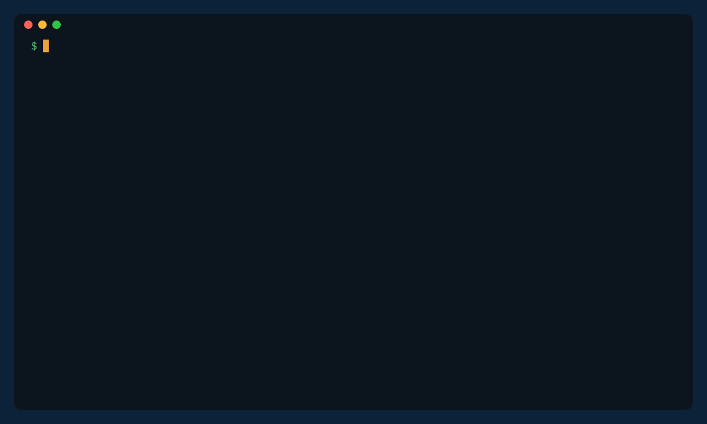

<picture>
  <source media="(prefers-color-scheme: dark)" srcset=".github/readme/hero-dark.svg">
  
</picture>

<p align="center">
  <a href="https://github.com/keelinfra/jenkins-bench/actions/workflows/ci.yml"></a>
  <a href="https://github.com/keelinfra/jenkins-bench/releases/latest"></a>
  <a href="#覆盖范围"></a>
  <a href="#token-能读到什么"></a>
  <a href="#许可"></a>
</p>

<p align="center">
  <a href="#试一下"><b>试一下</b></a> &nbsp;·&nbsp;
  <a href="#安装"><b>安装</b></a> &nbsp;·&nbsp;
  <a href="#覆盖范围"><b>覆盖范围</b></a> &nbsp;·&nbsp;
  <a href="docs/guide.zh-CN.md"><b>使用指南</b></a> &nbsp;·&nbsp;
  <a href="README.md"><b>English</b></a>
</p>

<br>

jenkins-bench 按 [CIS 软件供应链安全指南](https://www.cisecurity.org/benchmark/software-supply-chain-security)第 2 章（Build Pipelines）审计一台 **Jenkins 控制器**。它以**只读**方式抓取控制器的快照（任务、凭据元数据、agent、插件），每条控制项用一条 Rego 策略评估，告诉你哪里配置有误，以及修复它的确切设置路径。

```sh
jenkins-bench scan --url https://jenkins.example.com --username audit --token "$JENKINS_TOKEN"
```

### 试一下

不需要控制器，也不需要 token：`--demo` 会评估二进制里自带的示例控制器。

```sh
docker run --rm -t ghcr.io/keelinfra/jenkins-bench:latest scan --demo
```

<p align="center">
  
</p>

## 看不到的控制项报告 MANUAL

**无法评估的控制项报告 `MANUAL`，绝不报告 `PASS` 或 `FAIL`。** 扫描不会因为一个问不出口的问题加分，也不会因此扣分。

这条规则在 Jenkins 上马上见效。最小权限 token（`Overall/Read` 加 `Job/Read`）读不到任何一个任务的配置，于是所有任务级控制项都报告 `MANUAL`，扫描在 stderr 说明原因，评分把它们排除在外。`scan.maxManual` 让 CI 可以拒绝一次“看到的太少”的扫描。没能完成的扫描（比如 token 拿到的是空任务列表）以 2 退出，而不是 0。

## Token 能读到什么

对照 Jenkins 2.580.1 实测，[`hack/e2e`](hack/e2e) 里每一行都有对应账号：

| Token 权限 | 能回答的问题 |
| --- | --- |
| `Overall/Read` | 认证、CSRF、匿名探针、内置节点、agent |
| + `Job/Read` | 任务列表、哪些任务被禁用；没有它，Jenkins 返回一个*空*列表，扫描以 2 退出 |
| + `Job/ExtendedRead` | 全部任务级控制项：任务如何定义、沙箱与 Groovy 脚本、触发器 |
| + `Overall/SystemRead` | 插件及其更新状态 |
| + `Credentials/View` | 控制器自身凭据存储里的凭据元数据 |

推荐用 `Overall/Read`、`Job/Read`、`Job/ExtendedRead` 加 `Overall/SystemRead` 扫描：能回答每一条自动化控制项，又改不了任何东西。后两个需要显式开启，启动控制器时加 `-Dhudson.security.ExtendedReadPermission=true` 和 `-Djenkins.security.SystemReadPermission=true`。请用 API token，不要用密码。

每个请求都是 GET：有测试保证，HTTP 客户端拒绝其他方法，每次扫描结束时都会清点：

```
[INFO] ✓ 31 requests · 31 GET · 0 writes · read-only
```

快照里没有任何密文：触发 token 只记录有没有，SCM URL 里的凭据会被剥掉，所以 `--snapshot-out` 的文件可以放心附在 bug 报告里。

## 安装

```sh
go install github.com/keelinfra/jenkins-bench/cmd/jenkins-bench@latest
```

也可以从 [Releases](https://github.com/keelinfra/jenkins-bench/releases) 下载压缩包（校验和用 cosign 签名，附 SBOM 与构建来源证明），或使用容器镜像 `ghcr.io/keelinfra/jenkins-bench`。

```sh
jenkins-bench scan ... --details                       # 逐任务发现与完整修复步骤
jenkins-bench scan ... --folder platform --job deploy   # 缩小扫描范围
jenkins-bench scan ... -o sarif --output-file jenkins.sarif   # 还有 json、junit
jenkins-bench scan ... --snapshot-out jenkins.json      # 之后离线重新评估
jenkins-bench init                                      # 带注释的配置，每个默认值都写明
```

退出码、GitHub Actions / Jenkins / Azure Pipelines 的 CI 用法、大型控制器、评分和配置，见**[使用指南](docs/guide.zh-CN.md)**。

## 覆盖范围

指南第 2 章共 28 条控制项。这 15 条是控制器 API 能回答的全部，加上只能以手工形式诚实呈现、并写明答案在哪里的几条。其余的会先在真实控制器上实测再上线，不靠猜。

| ID | 严重度 | 范围 | 自动化 | 标题 |
| --- | --- | --- | --- | --- |
| CIS-2.1.1 | MEDIUM | job | 手工 | Ensure each pipeline has a single responsibility |
| CIS-2.1.2 | HIGH | job | 是 | Ensure all aspects of the pipeline infrastructure and configuration are immutable |
| CIS-2.1.3 | MEDIUM | controller | 是 | Ensure the build environment is logged |
| CIS-2.1.4 | MEDIUM | controller | 手工 | Ensure the creation of the build environment is automated |
| CIS-2.1.5 | MEDIUM | controller | 是 | Ensure access to build environments is limited |
| CIS-2.1.6 | HIGH | controller | 是 | Ensure users must authenticate to access the build environment |
| CIS-2.2.1 | MEDIUM | controller | 手工 | Ensure build workers are single-used |
| CIS-2.2.3 | HIGH | controller | 是 | Ensure the duties of each build worker are segregated |
| CIS-2.2.4 | MEDIUM | controller | 手工 | Ensure build workers have minimal network connectivity |
| CIS-2.2.6 | MEDIUM | controller | 手工 | Ensure build workers are automatically scanned for vulnerabilities |
| CIS-2.3.1 | HIGH | job | 是 | Ensure all build steps are defined as code |
| CIS-2.3.4 | MEDIUM | job | 手工 | Ensure changes to pipeline files are tracked and reviewed |
| CIS-2.3.5 | MEDIUM | job | 是 | Ensure access to build process triggering is minimized |
| CIS-2.3.8 | MEDIUM | controller | 手工 | Ensure scanners are in place to identify and prevent sensitive data in pipeline files |
| JENKINS-PLUGIN-UPDATES | MEDIUM | controller | 是 | Ensure installed plugins are up to date |

每条控制项实际读什么、背后的 API 实测结论，见[使用指南](docs/guide.zh-CN.md#覆盖范围)和 [`docs/jenkins-api-notes.md`](docs/jenkins-api-notes.md)。

## 参与贡献

最有用的贡献是拿它扫一台真实控制器，然后报告哪里不一样。[`hack/e2e`](hack/e2e) 会启动一台每条控制项状态都已知的控制器，按每种 token 核对每个结论；它在 Jenkins 2.580.1 和 2.541.3（LTS）上通过。从 [CONTRIBUTING.md](CONTRIBUTING.md) 开始；安全问题请按 [SECURITY.md](SECURITY.md) 私下报告。

## 许可

Apache 2.0，见 [LICENSE](LICENSE)。

<sub>与 CIS 及 Jenkins 项目无关联。</sub>
